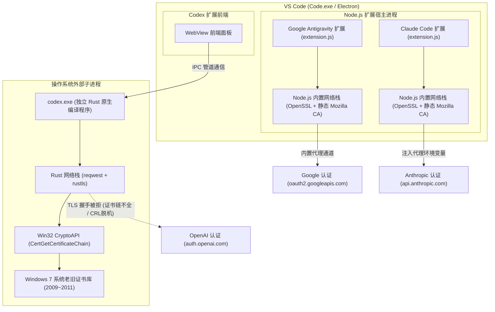

# 主流 AI 插件（Antigravity / Claude Code / Codex）认证架构及 TLS 证书链处理机制对比分析（2026-10-18）

## 一、背景与问题引出

在同一台 Windows 7 SP1 x64（运行 VxKex NEXT）与 VS Code 便携版（`D:\VSCode-win32-x64-1.107.1`）开发环境中：
- **Google Antigravity 插件**：可通过浏览器顺畅完成 OAuth 认证并正常与云端进行交互；
- **Anthropic Claude Code 插件**：可正常加载并与 Anthropic 官方服务通信；
- **OpenAI Codex 插件**：在通过外部浏览器授权跳转回本地后，却在后台换取 Token 阶段报错：
  ```text
  Token exchange failed: error sending request for url (https://auth.openai.com/oauth/token)
  Error code: token_exchange_failed
  ```

三者同为 VS Code 主流 AI 扩展且均涉及浏览器授权/云端 API 交互，为什么 Antigravity 和 Claude Code 均能正常登录，而唯独 Codex 插件会产生严重的 TLS 握手拒绝与 Token 换取失败？

本文对三者的底层运行架构、TLS 协议栈、证书信任链及代理感知机制进行深度对比与溯源。

---

## 二、运行宿主与进程执行模型对比



### 1. Antigravity 插件：纯 JavaScript/TypeScript 进程内运行
- **插件形态**：纯 VS Code JavaScript 扩展（主入口 `extension.js`）；
- **执行宿主**：直接由 VS Code 自带的 **Node.js / Electron 扩展宿主进程（`Code.exe`）** 加载并在同一进程空间内运行；
- **网络调用**：所有 OAuth 授权、状态读取以及向云端发起的 HTTPS 请求，都是直接调用 Node.js 内置的 `fetch` / `https` 模块完成。

### 2. Claude Code 插件：Node.js 生态驱动的应用架构
- **插件形态**：VS Code 扩展前端 + 基于 Node.js 的 Claude 核心引擎（基于 `@anthropic-ai/claude-code`）；
- **执行宿主**：其底层交互逻辑与 CLI 均基于 **Node.js 运行时** 执行；
- **网络调用**：与 Anthropic API 交互使用的是 Node.js 内置的 `fetch` / `undici`（底层由 OpenSSL 驱动），即使拉起子进程也是 Node.js 进程。

### 3. Codex 插件：混合分层架构与独立 Rust 原生子进程
- **插件形态**：混合分层架构。VS Code 端安装的仅为**前端 WebView 壳**（`webview/assets/*.js`）；
- **执行宿主**：真正的核心后端（`app-server`）是一个完全独立的、用 **Rust 语言编译的原生 64 位可执行程序（`codex.exe`）**；
- **网络调用**：VS Code 前端通过 IPC 管道向 `codex.exe` 发送指令。当用户在前端点击登录并完成浏览器重定向后，接收本地回调并在后台向 `https://auth.openai.com/oauth/token` 发起 POST 请求换取 Access Token 的，是**完全独立运行的 `codex.exe` 进程**。

---

## 三、TLS 网络栈与根证书信任链来源的三方对比

| 核心维度 | Antigravity（Google） | Claude Code（Anthropic） | Codex（OpenAI） |
| :--- | :--- | :--- | :--- |
| **主进程开发语言** | TypeScript / JavaScript | TypeScript / JavaScript | **Rust（原生二进制）** |
| **底层运行时** | Node.js (Electron) | Node.js (Electron / Node) | **无运行时（Native PE）** |
| **底层 TLS 引擎** | **OpenSSL** | **OpenSSL** | **`rustls-0.23`** |
| **根证书来源** | **静态内嵌 Mozilla 现代 CA 根证书库** | **静态内嵌 Mozilla 现代 CA 根证书库** | **委托给 Windows 7 原生 CryptoAPI**（`rustls-platform-verifier`） |
| **Win7 系统证书依赖** | **完全不依赖** | **完全不依赖** | **强依赖** Windows 7 系统证书存储区 |
| **现代 ECC 根证书** | 自带最新 GlobalSign R4、GTS、ISRG Root | 自带最新 GlobalSign R4、GTS、ISRG Root | Win7 原生证书库停滞在 2009 年，缺失 2012+ ECC 根证书 |
| **证书链验证结果** | 验证通过（`TRUST OK`） | 验证通过（`TRUST OK`） | 缺少中间/根证书，报 `CERT_TRUST_IS_PARTIAL_CHAIN (0x10000)` |
| **CRL 吊销检查机制** | 默认**不强制**进行在线 CRL/OCSP 下载 | 默认**不强制**进行在线 CRL/OCSP 下载 | 遵循 Win7 注册表（`CertificateRevocation=1`），直连被墙返回 `0x80092013` |

### 1. Node.js 生态的「自备干粮」哲学（Antigravity 与 Claude Code）
Node.js（以及基于 Electron 的 VS Code）在源码构建时，官方将 Mozilla 最新认证的 `certdata.txt`（包含全球数百张权威根证书）直接编译成 C++ 常量数组（`src/node_crypto.cc` 中的 `rootCertificates`）。
- **结果**：即便宿主操作系统是 2009 年发布的 Windows 7，Node.js 内部也拥有一套完整的现代 Mozilla 根证书库，能够自动信任由现代 CA（如 Google Trust Services、Let's Encrypt ISRG Root、Cloudflare、GlobalSign ECC R4）签发的任何合法证书；
- **吊销策略**：OpenSSL / Node.js 默认不做阻断式的在线 CRL 下载，即使 CRL 服务器被防火墙阻断也不会影响连接。

### 2. Rust 生态的「系统集成」哲学（Codex）
`codex.exe` 采用了 Rust 的 `rustls-platform-verifier`（源码位于 `windows.rs`），追求轻量化并尊重操作系统管理策略。
- 该库在 Windows 平台上的设计是：**调用 Win32 原生 CryptoAPI 函数（`CertGetCertificateChain` 与 `CertVerifyCertificateChainPolicy`）**，完全依赖宿主系统的证书库；
- **Windows 7 的双重致命缺陷**：
  1. Windows 7 SP1 原生根证书库仅包含 2009~2011 年的老旧 RSA 证书，现代网站普遍使用的 ECC 根证书（如 `GlobalSign ECC Root CA - R4` 于 2012 年底发布）在 Win7 系统证书库中**根本不存在**；
  2. Win7 注册表默认开启 `CertificateRevocation = 1`（在线吊销检查）。CryptoAPI 试图访问证书指定的 Google CRL 服务器（`http://c.pki.goog/...`），在国内网络环境下直接被墙超时，返回 `0x80092013`（`CRYPT_E_REVOCATION_OFFLINE`）；
  3. `rustls-platform-verifier` 检测到系统返回脱机或证书链不全，直接作为硬错误终止 TLS 握手（`is_connect=true error sending request`）。

---

## 四、VS Code 代理感知与配置继承机制对比

### 1. Antigravity 插件
- 运行在 `Code.exe` 内部，可以直接通过 VS Code API 读取内存中的代理设置；
- 受益于 [`settings.json`](file:///d:/VSCode-win32-x64-1.107.1/data/user-data/User/settings.json#L2-L3) 中的全局配置：
  ```json
  "http.proxy": "http://192.168.x.x:10809",
  "http.proxyStrictSSL": false
  ```
- VS Code 自动为内置 Node.js 网络请求注入代理管道；`"http.proxyStrictSSL": false` 还会放宽严格校验。

### 2. Claude Code 插件
- VS Code `settings.json` 中原生支持并配置了专门的 Claude 环境变量继承块：
  ```json
  "claudeCode.environmentVariables": [
      { "name": "HTTPS_PROXY", "value": "http://192.168.x.x:10809" },
      { "name": "HTTP_PROXY", "value": "http://192.168.x.x:10809" }
  ]
  ```
- 插件在拉起任何 CLI 交互或工作进程时，会自动将此代理变量附加到子进程的环境中，保证了代理路由的连通。

### 3. Codex 插件（`codex.exe`）
- 作为完全独立的外部二进制文件，**无法读取 VS Code 内部内存变量，也没有插件级别的自动环境变量注入机制**；
- 它完全依赖于操作系统级别的用户环境变量（`HKCU\Environment`）；
- 若没有在操作系统层面持久化设置 `HTTP_PROXY`、`HTTPS_PROXY` 以及 `SSL_CERT_FILE`，`codex.exe` 启动后就只能裸连网络，并直接向过时的 Windows 7 系统请求证书校验。

---

## 五、结论与启示

1. **三大插件行为差异总结**：
   - **Antigravity**：Node.js 进程内 + 内置 Mozilla 根证书库 + VS Code 代理管道托管，全链路免疫 Windows 7 系统缺陷；
   - **Claude Code**：Node.js 生态 + 内置 Mozilla 根证书库 + 专有 `claudeCode.environmentVariables` 代理注入，全链路免疫 Windows 7 系统缺陷；
   - **Codex**：独立 Rust 原生可执行程序 + 依赖 Windows 7 原生 CryptoAPI，直接承接了 Windows 7 缺少现代根证书、CRL 离线误报以及缺乏代理注入的三重打击。

2. **解决措施的本质**：
   - 本次在 Windows 用户全局环境变量中配置：
     `SSL_CERT_FILE = C:\Program Files\Git\mingw64\etc\ssl\certs\ca-bundle.crt`
     本质上就是**手动为 Rust 进程（`codex.exe`）注入了与 Node.js 相同水准的现代全量 Mozilla 根证书库**；
   - 配合将 Windows 注册表的 `CertificateRevocation` 设为 `0` 并补全 `HTTP_PROXY` / `HTTPS_PROXY`，彻底对齐了现代 Rust 原生进程与 Node.js 插件在 Windows 7 上的网络与安全能力。

---

## 六、扩展排查：OAuth 本地回调代理死循环（localhost）与账号风控（account_on_hold）

在实际使用 Claude Code / Codex 等插件登录时，用户还遇到了另外两类高频认证衍生问题：

### 1. 本地回调代理死循环陷阱（`http://localhost:<port>/callback?code=...` 报错）
- **现象**：
  在浏览器中完成授权后，页面重定向至本地回调地址（例如 `http://localhost:54495/callback?code=...&state=...`），但浏览器报错显示：
  `无法访问此网站`、`ERR_CONNECTION_RESET`、`ERR_CONNECTION_REFUSED` 或 `10054 远程主机强迫关闭了一个现有的连接`。
- **根本原因**：
  - 插件（如 `claude.exe` 或 `codex.exe`）会在当前本机启动一个临时的 HTTP 监听端口（如 54495、1455）用于捕获授权码；
  - Windows 系统代理开启了局域网代理服务器（如 `192.168.x.x:10809`），但注册表中的代理例外列表 `ProxyOverride` 仅设置了默认的 `<local>`；
  - 现代浏览器（Chrome / Edge）对于带有端口的 `http://localhost:<port>`，若未明确设置例外，会将其**转发至局域网代理服务器 `192.168.x.x`**；
  - 代理服务器收到请求后尝试连接**代理服务器自己机器上的对应端口**（并非用户这台 Win7 本机），因无服务监听而立即强行掐断连接（`WinError 10054 ConnectionReset`），导致本地程序无法拿到回调授权码。
- **解决措施**：
  1. **永久修复（系统代理白名单）**：
     在注册表 `HKCU\Software\Microsoft\Windows\CurrentVersion\Internet Settings` 中，将 `ProxyOverride` 更新为：
     ```text
     ProxyOverride = localhost;127.0.0.1;<local>
     ```
     强制所有遵守系统代理的软件和浏览器在访问 `localhost` 或 `127.0.0.1` 时严禁走代理，必须本机回环直连。
  2. **临时应急修复**：
     在报错的浏览器地址栏中，直接将 `localhost` 手动替换为 `127.0.0.1` 回车：
     ```text
     http://127.0.0.1:54495/callback?code=...&state=...
     ```
     现代浏览器对纯数字 IP `127.0.0.1` 具有硬编码的代理豁免权，可直接送达本机监听程序。

### 2. 服务端风控拦截（`error_description=account_on_hold`）
- **现象**：
  浏览器授权跳转回调返回：
  ```text
  http://localhost:54105/callback?error=access_denied&error_description=account_on_hold&error_uri=https%3A%2F%2Fclaude.ai%2Frestricted&state=...
  ```
- **根本原因**：
  - 并非本地 TLS 证书或网络层故障（网络及 TLS 握手均已成功）；
  - 属于 Anthropic 服务端业务级安全风控拦截：当前账号被 Anthropic 官方标记为 `account_on_hold`（挂起/受限），通常是由代理出口 IP 属于机房高风险 IP、多人共享节点、跨区域突变或支付方式风控触发。
- **解决措施**：
  1. 登录 `claude.ai` 检查账号横幅，提交「Request a review」人工审核申诉；
  2. 更换纯净度更高的独享/住宅节点；
  3. 改用 API Key 模式（设置环境变量 `ANTHROPIC_API_KEY`）直连，绕开网页端严格的 OAuth 账号风控。

