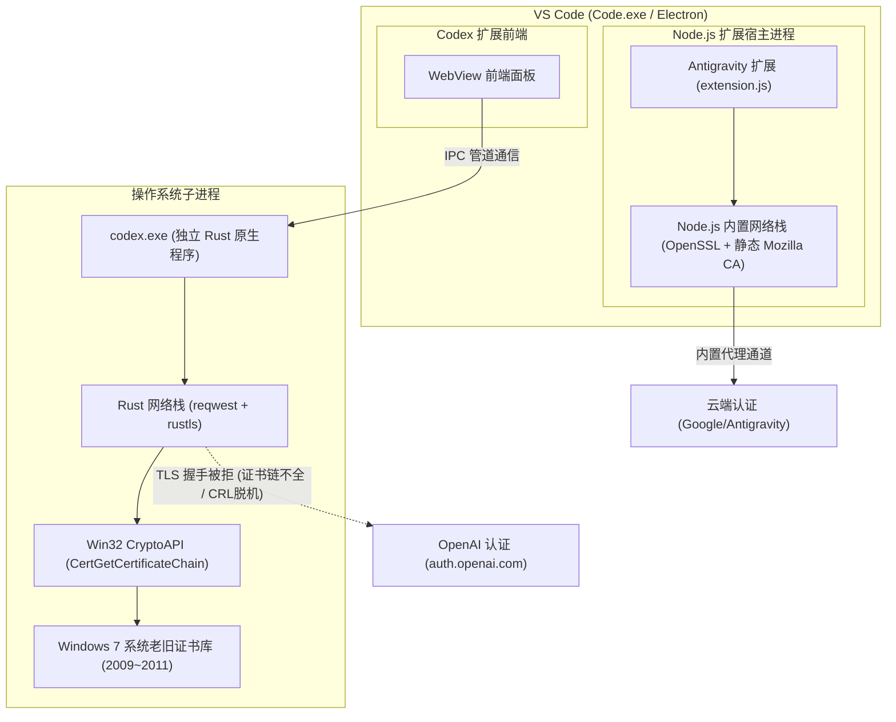

# Antigravity 与 Codex 插件认证架构及 TLS 证书链处理机制对比分析（2026-10-18）

## 一、背景与问题引出

在同一台 Windows 7 SP1 x64（运行 VxKex NEXT）与 VS Code 便携版（`D:\VSCode-win32-x64-1.107.1`）开发环境中：
- **Antigravity 插件**：可通过浏览器顺畅完成 OAuth 认证并正常与云端进行大模型交互；
- **Codex 插件**：在通过外部浏览器授权跳转回本地后，却在后台换取 Token 阶段报错：
  ```text
  Token exchange failed: error sending request for url (https://auth.openai.com/oauth/token)
  Error code: token_exchange_failed
  ```

两者同为 VS Code 扩展且均涉及浏览器 OAuth 授权回调流程，为何表现出截然不同的行为？本文对两者的底层运行架构、TLS 协议栈、证书信任链及代理感知机制进行深度对比与溯源。

---

## 二、运行宿主与进程执行模型对比



### 1. Antigravity 插件：纯 JavaScript/TypeScript 进程内运行
- **插件形态**：标准的 VS Code JavaScript 扩展（主入口 `extension.js`）；
- **执行宿主**：直接由 VS Code 自带的 **Node.js / Electron 扩展宿主进程（`Code.exe`）** 加载并运行在同一进程空间内；
- **网络调用**：所有的 OAuth 授权、状态读取以及向云端发起的 HTTPS 请求，都是直接调用 Node.js 内置的 `fetch` / `https` / `axios` 模块完成。

### 2. Codex 插件：混合分层架构与独立 Rust 原生子进程
- **插件形态**：混合分层架构。VS Code 端安装的仅为**前端 WebView 壳**（`webview/assets/*.js`）；
- **执行宿主**：真正的核心后端（`app-server`）是一个完全独立的、用 **Rust 语言编译的原生 64 位可执行程序（`codex.exe`）**；
- **网络调用**：VS Code 前端通过 IPC 管道（`stdin`/`stdout`）向 `codex.exe` 发送指令。当用户在前端点击登录并完成浏览器重定向后，接收本地回调并在后台向 `https://auth.openai.com/oauth/token` 发起 POST 请求换取 Access Token 的，是**完全独立运行的 `codex.exe` 进程**。

---

## 三、TLS 网络栈与根证书信任链来源的本质差异

| 核心维度 | Antigravity 插件（Node.js / Electron） | Codex 插件（`codex.exe` / Rust） |
| :--- | :--- | :--- |
| **底层 TLS 引擎** | **OpenSSL**（内嵌于 Node.js 源码中） | **`rustls-0.23`** |
| **根证书来源** | **静态内嵌 Mozilla 现代 CA 根证书库** | **委托给 Windows 7 原生 CryptoAPI**（`rustls-platform-verifier`） |
| **Win7 系统证书依赖** | **完全不依赖** Windows 7 系统证书库 | **强依赖** Windows 7 系统注册表与系统证书存储区 |
| **现代 ECC 根证书** | 自带最新 GlobalSign R4、GTS、ISRG Root | Win7 原生证书库停滞在 2009 年，缺失 2012+ ECC 根证书 |
| **证书链验证结果** | 验证通过（`TRUST OK`） | 缺少中间/根证书，报 `CERT_TRUST_IS_PARTIAL_CHAIN (0x10000)` |
| **CRL 吊销检查机制** | 默认**不强制**进行在线 CRL/OCSP 下载 | 遵循 Win7 注册表（`CertificateRevocation=1`），直连被墙返回 `0x80092013` |

### 1. Node.js 的「自带根证书」机制
Node.js 在源码构建时，官方会将 Mozilla 最新认证的 `certdata.txt`（包含全球数百张权威根证书）直接编译成 C++ 常量数组（`src/node_crypto.cc` 中的 `rootCertificates`）。
- **结果**：即便宿主操作系统是 2009 年发布的 Windows 7，Node.js 内部也是一套最新的 2026 年 Mozilla 根证书库，能够自动信任由现代 CA（如 Google Trust Services、Let's Encrypt ISRG Root、Cloudflare、GlobalSign ECC R4）签发的任何合法证书。

### 2. Rust `rustls-platform-verifier` 的「系统委托」机制
`codex.exe` 为了减小体积并遵守不同操作系统的企业管理策略，采用了 `rustls-platform-verifier` 库（源码位于 `windows.rs`）。
- 该库在 Windows 平台上的设计是：**调用 Win32 原生 CryptoAPI 函数（`CertGetCertificateChain` 与 `CertVerifyCertificateChainPolicy`）**，让 Windows 操作系统自行评估证书链；
- **Windows 7 的致命短板**：
  1. Windows 7 SP1 原生根证书库仅包含 2009~2011 年的老旧 RSA 证书，现代网站普遍使用的 ECC 根证书（如 `GlobalSign ECC Root CA - R4` 于 2012 年底发布）在 Win7 系统证书库中**根本不存在**；
  2. Win7 注册表默认开启 `CertificateRevocation = 1`（在线吊销检查）。CryptoAPI 试图访问证书指定的 Google CRL 服务器（`http://c.pki.goog/...`），在国内网络环境下直接被墙超时，返回 `0x80092013`（`CRYPT_E_REVOCATION_OFFLINE`）；
  3. `rustls-platform-verifier` 检测到系统返回脱机或证书链不全，直接作为硬错误终止 TLS 握手（`is_connect=true error sending request`）。

---

## 四、VS Code 代理感知与配置继承机制对比

### 1. Antigravity 插件直接受益于 VS Code 的代理中继与安全豁免
在 VS Code 便携版配置 [`settings.json`](file:///d:/VSCode-win32-x64-1.107.1/data/user-data/User/settings.json#L2-L3) 中：
```json
"http.proxy": "http://192.168.x.x:10809",
"http.proxyStrictSSL": false
```
- Antigravity 运行在 `Code.exe` 内部，可以直接通过 VS Code API 读取内存中的代理设置；
- VS Code 自动为内置 Node.js 网络请求注入代理管道；
- `"http.proxyStrictSSL": false` 会在 Node.js 中自动禁用严格的 TLS 校验，即使遇到证书异常也能宽容通行。

### 2. `codex.exe` 是外部进程，无法感知 VS Code 内部配置
- 作为一个外部独立子进程，`codex.exe` **无法读取 VS Code 的内部内存变量或 `settings.json`**；
- 它的网络层（`reqwest`）只遵从操作系统标准环境变量（`HTTP_PROXY`、`HTTPS_PROXY`、`SSL_CERT_FILE`）；
- 如果在启动 VS Code 前未在 Windows 用户注册表或系统环境中显式注入这些环境变量，`codex.exe` 启动后就会陷入无外部根证书包、无代理配置的境地，从而直接裸连并撞上 Windows 7 系统的证书缺陷。

---

## 五、结论与启示

1. **为什么表现不同**：
   - Antigravity 走的是 **Node.js 内部最新 Mozilla 根证书库 + VS Code 托管的免检代理**，天然免疫 Windows 7 系统的老旧限制；
   - Codex 走的是 **独立 Rust 原生可执行文件 + Windows 7 原生 CryptoAPI**，完整承接了 Windows 7 缺少现代根证书与 CRL 吊销服务器被阻断的双重打击。
2. **解决措施的本质**：
   - 本次在用户环境变量中配置 `SSL_CERT_FILE = C:\Program Files\Git\mingw64\etc\ssl\certs\ca-bundle.crt`，本质上就是**手动给 `codex.exe` 注入了与 Node.js 完全同等级别的现代 Mozilla 全量根证书库**；
   - 配合将 `CertificateRevocation` 设为 `0` 并补全 `HTTP_PROXY` / `HTTPS_PROXY`，彻底消除了 Windows 7 与外部现代 Rust 原生程序之间的环境鸿沟。
